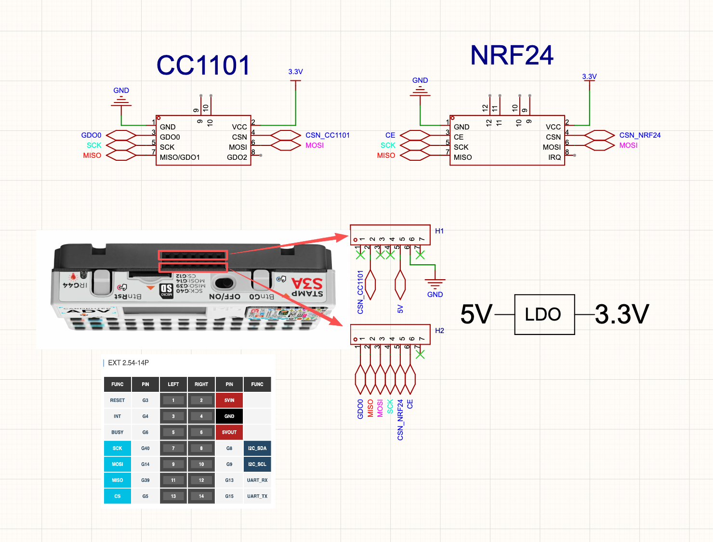

# Pin Mapping Reference

Full GPIO assignments for the CC1101 + NRF24 dual-radio setup on the M5Stack Cardputer ADV.

---

## Quick Reference

| Function | GPIO | Direction | Header Pin |
|---|---|---|---|
| SCK | GPIO 40 | OUT | EXT 7 |
| MOSI | GPIO 14 | OUT | EXT 9 |
| MISO | GPIO 39 | IN | EXT 11 |
| CC1101 CSN | GPIO 13 | OUT | EXT 12 |
| CC1101 GDO0 | GPIO 5 | IN | EXT 13 |
| NRF24 CSN | GPIO 6 | OUT | EXT 5 |
| NRF24 CE | GPIO 4 | OUT | EXT 3 |
| 5V in | — | — | EXT 6 (5VOUT) |
| GND | — | — | EXT 4 |

Not connected: CC1101 GDO2, CC1101 RST, NRF24 IRQ, NRF24 RST.

---

## Cardputer ADV EXT Header Map

The 14-pin extension header on Cardputer ADV. Pins marked ✅ are used by this design.

| Pin | M5Stack Label | Used? | Purpose |
|---|---|---|---|
| 1 | RESET (G3) | — | free |
| 2 | 5VIN | — | free |
| 3 | INT (G4) | ✅ | NRF24 CE |
| 4 | GND | ✅ | ground |
| 5 | BUSY (G6) | ✅ | NRF24 CSN |
| 6 | 5VOUT | ✅ | 5V to regulator |
| 7 | SCK (G40) | ✅ | shared SPI clock |
| 8 | G8 | — | free (I2C SDA on ADV) |
| 9 | MOSI (G14) | ✅ | shared SPI MOSI |
| 10 | G9 | — | free (I2C SCL on ADV) |
| 11 | MISO (G39) | ✅ | shared SPI MISO |
| 12 | G13 | ✅ | CC1101 CSN |
| 13 | CS (G5) | ✅ | CC1101 GDO0 |
| 14 | G15 | — | free |

The "M5Stack Label" column reproduces the PinMap in M5Stack's official [Cardputer-Adv documentation](https://docs.m5stack.com/en/core/Cardputer-Adv) — pins 8, 9, 12 and 14 are listed there by GPIO number only, with no assigned function. Several labelled pins are repurposed in this design; that is normal on ESP32-S3, where the GPIO matrix makes most peripheral assignments flexible.

Note that pins 12 and 13 are easy to transpose: **GPIO 13 is on pin 12**, and pin 13 carries GPIO 5.

---

## Pre-Power-On Multimeter Check

A 2-minute check that catches most wiring mistakes:

**Continuity (should beep):**
- EXT 7 ↔ CC1101 SCK ↔ NRF24 SCK
- EXT 9 ↔ CC1101 MOSI ↔ NRF24 MOSI
- EXT 11 ↔ CC1101 MISO ↔ NRF24 MISO

**Continuity (should NOT beep):**
- CC1101 CSN ↔ NRF24 CSN — these are independent and must NOT be tied together

**Voltage (with regulator only, modules disconnected):**
- LDO output reads 3.3V ±0.1V

If the CSN-to-CSN check beeps, stop and rewire — the build won't work otherwise.
